  

  <picture>
    <source media="(prefers-color-scheme: dark)" srcset="assets/tagline-dark.svg" />
    
  </picture>

<!-- ======================================================== -->
<!-- COMMAND DOCK                                             -->
<!-- ======================================================== -->

  
  &nbsp;
  
  &nbsp;
  
  &nbsp;
  
  &nbsp;
  

 

<!-- ======================================================== -->
<!-- 01 // RIGHT NOW                                          -->
<!-- ======================================================== -->

  <picture>
    <source media="(prefers-color-scheme: dark)" srcset="assets/heading-now-dark.svg" />
    
  </picture>

<table>
  <tr>
    <td width="55%" valign="top">
      <h3>🏛️ NITC Venue Booking Portal</h3>
      <b>Core Developer</b> · CSEA &amp; CSC, NIT Calicut  
      <ul>
        <li>Automated calendar booking and venue conflict handling.</li>
        <li>Auto-refresh JWT authentication with role-based access control.</li>
        <li>Built for high-concurrency campus event bookings.</li>
      </ul>
      <code>Next.js</code> &nbsp; <code>TypeScript</code> &nbsp; <code>Prisma</code> &nbsp; <code>PostgreSQL</code> &nbsp; <code>TailwindCSS</code>
        
      <a href="https://github.com/MUHSIN-M-P/venue-portal-backend-csea"><b>View Backend Repo ↗</b></a>
        
      🎓 B.Tech CSE · National Institute of Technology Calicut ('26)
    </td>
    <td width="45%" valign="top">
      <b>🪟 HyprQuickFrame &amp; Linux Dotfiles</b> 
      QML-powered screen workflow tool and HUD for Wayland / Hyprland with automated dotfile syncing. 
      <code>QML</code> &nbsp; <code>C++</code> &nbsp; <code>Hyprland</code> &nbsp; <code>Wayland</code> 
      <a href="https://github.com/MUHSIN-M-P/HyprQuickFrame"><b>View Repo ↗</b></a>
        
      <b>🐳 Secure Container Access Manager &amp; eXpServer</b> 
      Python CLI for Docker role-based access control and session logs, alongside socket network labs in C. 
      <code>Python</code> &nbsp; <code>Docker</code> &nbsp; <code>C Sockets</code> 
      <a href="https://github.com/MUHSIN-M-P/Secure-Container-Access-Manager"><b>View Repo ↗</b></a>
    </td>
  </tr>
</table>

 

<!-- ======================================================== -->
<!-- 02 // TECH STACK                                         -->
<!-- ======================================================== -->

  <picture>
    <source media="(prefers-color-scheme: dark)" srcset="assets/heading-toolkit-dark.svg" />
    
  </picture>

  

<table>
  <tr>
    <td width="25%" valign="top">
      <b>⚡ LANGUAGES</b>
      <ul>
        <li>C++</li>
        <li>C</li>
        <li>TypeScript</li>
        <li>JavaScript</li>
        <li>Python</li>
        <li>SQL</li>
        <li>QML</li>
      </ul>
    </td>
    <td width="25%" valign="top">
      <b>🌐 FRONTEND</b>
      <ul>
        <li>Next.js</li>
        <li>React</li>
        <li>Tailwind CSS</li>
        <li>HTML5 / CSS3</li>
      </ul>
    </td>
    <td width="25%" valign="top">
      <b>🗄️ BACKEND &amp; DB</b>
      <ul>
        <li>Node.js / Express</li>
        <li>FastAPI / Flask</li>
        <li>PostgreSQL</li>
        <li>Prisma ORM</li>
      </ul>
    </td>
    <td width="25%" valign="top">
      <b>🛠️ SYSTEMS &amp; TOOLS</b>
      <ul>
        <li>Linux (Hyprland)</li>
        <li>Docker</li>
        <li>Git &amp; GitHub</li>
        <li>Socket Programming</li>
        <li>Postman</li>
        <li>VS Code</li>
      </ul>
    </td>
  </tr>
</table>

 

<!-- ======================================================== -->
<!-- 03 // RECENT ACTIVITY                                    -->
<!-- ======================================================== -->

  <picture>
    <source media="(prefers-color-scheme: dark)" srcset="assets/heading-activity-dark.svg" />
    
  </picture>

 

| 📦 Repository | 💬 Commit &amp; Message | 🕒 When |
| :--------------------------------------------------------------------------------------------------------------------------------------------------------------------------------------------------------------------- | :------------------------------------------------------------------------------------------------------------------------------------------------------------------------------------------------------------------- | :----------------------------------------------------------------------------------------------------------------------------------------------------------------------------------------------------------------------------- |
| **[MUHSIN-M-P/MUHSIN-M-P](https://github.com/MUHSIN-M-P/MUHSIN-M-P)** | [`b194bcd`](https://github.com/MUHSIN-M-P/MUHSIN-M-P/commit/b194bcd8e21945bc3a344b69f3121b3050c727eb) 📝 Auto-update contributions in README [skip ci] | `11/25/2026` |
| **[cscnitc/blog-site](https://github.com/cscnitc/blog-site)** | [`1bf008f`](https://github.com/cscnitc/blog-site/commit/1bf008fe65476e8d5e3419185866ccf270fb6926) Removed duplicate header | `11/23/2026` |
| **[MUHSIN-M-P/HyprQuickFrame](https://github.com/MUHSIN-M-P/HyprQuickFrame)** | [`23d6f4d`](https://github.com/MUHSIN-M-P/HyprQuickFrame/commit/23d6f4dec3151a3757e7547033073968842a4c1e) Remove leftover temp files | `11/14/2026` |
| **[MUHSIN-M-P/eXpServer-Networks-Lab-NITC](https://github.com/MUHSIN-M-P/eXpServer-Networks-Lab-NITC)** | [`978f822`](https://github.com/MUHSIN-M-P/eXpServer-Networks-Lab-NITC/commit/978f822cc8a94c134829a29dbb25851e2c36db07) completed upto stage 19 | `11/10/2026` |
| **[IEEE-SB-NITC/ieee-sb-nitc](https://github.com/IEEE-SB-NITC/ieee-sb-nitc)** | [`60efe08`](https://github.com/IEEE-SB-NITC/ieee-sb-nitc/commit/60efe0801500459c74561c5870f1baf76837bde1) refactor: update counter page | `11/3/2026` |
| **[MUHSIN-M-P/My-dotfiles](https://github.com/MUHSIN-M-P/My-dotfiles)** | [`71e425f`](https://github.com/MUHSIN-M-P/My-dotfiles/commit/71e425f62326fdbc45dedcc6c53a536daaa0e503) refactor: refurbish dotfiles to support Noctalia v5 (C++) and greeter login screen (greetd) | `10/9/2026` |
| **[csea-nitc/venue-portal-backend](https://github.com/csea-nitc/venue-portal-backend)** | [`f83ab55`](https://github.com/csea-nitc/venue-portal-backend/commit/f83ab5548f57c96fc2e6ca0f4cd2b9bd7bb31220) removed prisma.config.ts due to build failure | `9/18/2026` |
| **[MUHSIN-M-P/venue-portal-backend-csea](https://github.com/MUHSIN-M-P/venue-portal-backend-csea)** | [`f83ab55`](https://github.com/MUHSIN-M-P/venue-portal-backend-csea/commit/f83ab5548f57c96fc2e6ca0f4cd2b9bd7bb31220) removed prisma.config.ts due to build failure | `9/18/2026` |
| **[csea-nitc/venue-portal-frontend](https://github.com/csea-nitc/venue-portal-frontend)** | [`97b6de0`](https://github.com/csea-nitc/venue-portal-frontend/commit/97b6de0f20caf342c2c26ea91e71fda33f4c5e44) added auto refresh jwt and venue calendar for venue_handler | `9/15/2026` |
| **[MUHSIN-M-P/venue-portal-frontend-csea](https://github.com/MUHSIN-M-P/venue-portal-frontend-csea)** | [`97b6de0`](https://github.com/MUHSIN-M-P/venue-portal-frontend-csea/commit/97b6de0f20caf342c2c26ea91e71fda33f4c5e44) added auto refresh jwt and venue calendar for venue_handler | `9/15/2026` |
| **[MUHSIN-M-P/Project-FindMyFriend](https://github.com/MUHSIN-M-P/Project-FindMyFriend)** | [`f3cdbe2`](https://github.com/MUHSIN-M-P/Project-FindMyFriend/commit/f3cdbe2087b1eb62ad97b90bbb5505ac4b614ecb) cors issue for token fixed | `7/9/2026` |
| **[MUHSIN-M-P/Quiz-app-Web-Development](https://github.com/MUHSIN-M-P/Quiz-app-Web-Development)** | [`1620627`](https://github.com/MUHSIN-M-P/Quiz-app-Web-Development/commit/1620627605605bd84cb9127be397db7499e0c8d4) fix: resolve security vulnerabilities via package overrides | `6/25/2026` |
| **[MUHSIN-M-P/NITC-Base--DBMS](https://github.com/MUHSIN-M-P/NITC-Base--DBMS)** | [`1665dc7`](https://github.com/MUHSIN-M-P/NITC-Base--DBMS/commit/1665dc7a61d7c90b55efb9af5530cad887507acf) updated readme | `6/16/2026` |
| **[MUHSIN-M-P/Secure-Container-Access-Manager](https://github.com/MUHSIN-M-P/Secure-Container-Access-Manager)** | [`140e1c0`](https://github.com/MUHSIN-M-P/Secure-Container-Access-Manager/commit/140e1c0d61e5904fd0d2fa155d24f0619762e6b0) some fixes for sql schema and typo fixed | `5/22/2026` |
| **[MUHSIN-M-P/Code-Track---DBMS-mini-Project](https://github.com/MUHSIN-M-P/Code-Track---DBMS-mini-Project)** | [`b89f288`](https://github.com/MUHSIN-M-P/Code-Track---DBMS-mini-Project/commit/b89f288516762ddf0957696917aceb615346a7bb) coding window | `4/6/2026` |
| **[MUHSIN-M-P/CodeSquad-CP-DSA-Tracker](https://github.com/MUHSIN-M-P/CodeSquad-CP-DSA-Tracker)** | [`a974d40`](https://github.com/MUHSIN-M-P/CodeSquad-CP-DSA-Tracker/commit/a974d4064d95ba7640d9d8173fcce439a65e421c) some fixes and advancements in leetcode fetching | `1/19/2026` |
| **[MUHSIN-M-P/Server-uptime-Monitor](https://github.com/MUHSIN-M-P/Server-uptime-Monitor)** | [`490ca0a`](https://github.com/MUHSIN-M-P/Server-uptime-Monitor/commit/490ca0ae4851f6f036a167c0fc87c3dc45ce6cc3) Update README.md | `1/3/2026` |
| **[MUHSIN-M-P/csc-blog-site](https://github.com/MUHSIN-M-P/csc-blog-site)** | [`3b9f6d1`](https://github.com/MUHSIN-M-P/csc-blog-site/commit/3b9f6d1a85d9e33ca89d7f518455292d19ba3fbe) major update with all needs | `12/8/2025` |

<!--END_CONTRIBUTED_REPOS-->

  

<b>Tested. Broken. Perfecting. Built On Resilience.</b> 
<a href="https://muhsin-m-p.vercel.app/"><b>muhsin-m-p.vercel.app</b></a>

  

